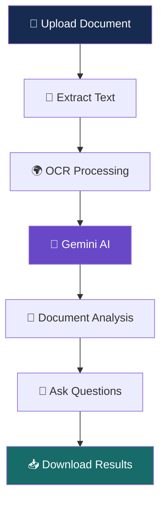

# 📄 PropDoc AI — Smart Document Intelligence

<div align="center"> 


<br/>


### Your documents. One intelligent AI workspace.

Upload, read, compare and understand documents with Artificial Intelligence.

<br/>

<a href="https://propdoc-ai-ulramnculq8wsxwlnc6wly.streamlit.app/">

</a>

<a href="#-features">

</a>

<br/><br/>


</div>

---

## 🌐 Quick Access

| Project Resource | Open |
|---|---|
| 🚀 Live.project | [PropDoc AI](https://propdoc-ai-ulramnculq8wsxwlnc6wly.streamlit.app/) |


## 🧠 About the Project

**PropDoc AI** is an AI-powered document intelligence platform built using Python, Streamlit, and Google Gemini.

It helps users extract information, understand document content, analyze important details, and interact with documents through an AI-powered assistant.

The platform is designed for multiple document categories, including:

- 🏠 Property and real estate documents
- ⚖️ Legal agreements and contracts
- 🎓 Educational documents
- 🏢 Business and company documents
- 💳 Financial documents
- 🪪 Identity and government documents
- 📑 General-purpose documents

## ✨ Features

<div align="center">

| 📂 Document Reader | 🤖 AI Analysis |
|:---:|:---:|
| Upload PDF documents and extract text | Generate intelligent document summaries |
| 🌍 Multilingual OCR | 💬 AI Assistant |
| Supports Marathi, Hindi and English | Ask questions about uploaded documents |
| 🔍 Document Understanding | 📥 Export Results |
| Identify document types and key details | Download extracted text and analysis |

</div>

## ⚡ How PropDoc AI Works



## 🎨 Design Experience

PropDoc AI features a modern glassmorphism-inspired interface:

- Frosted glass cards
- Elegant gradients
- Smooth visual transitions
- Rounded modern components
- Clean typography
- Responsive layout

## 🛠️ Technology Stack

<div align="center">


</div>

| Technology | Purpose |
|---|---|
| Python | Application development |
| Streamlit | Interactive web application |
| Google Gemini AI | Generative AI analysis |
| PyMuPDF | PDF text extraction |
| Pytesseract | OCR processing |
| Pillow | Image processing |
| GitHub | Source code management |

## 💻 Run the Project Locally

**1. Clone the repository**

```bash
git clone YOUR_GITHUB_REPOSITORY_URL
```

**2. Open the project folder**

```bash
cd YOUR_PROJECT_FOLDER
```

**3. Install dependencies**

```bash
pip install -r requirements.txt
```

**4. Configure your Gemini API key**

Create `.streamlit/secrets.toml`:

```toml
GEMINI_API_KEY = "YOUR_GEMINI_API_KEY"
```

Keep your API key private. Never commit your real secrets file to GitHub.

**5. Run PropDoc AI**

```bash
streamlit run app.py
```

---

## 🚀 Try PropDoc AI Now

<div align="center">


### Ready to explore smarter document analysis?

<a href="https://propdoc-ai-ulramnculq8wsxwlnc6wly.streamlit.app/">

</a>

<br/><br/>

**Built with ❤️ using Python, Streamlit & Generative AI**

*PropDoc AI — Making Document Intelligence Smarter.*

</div>
